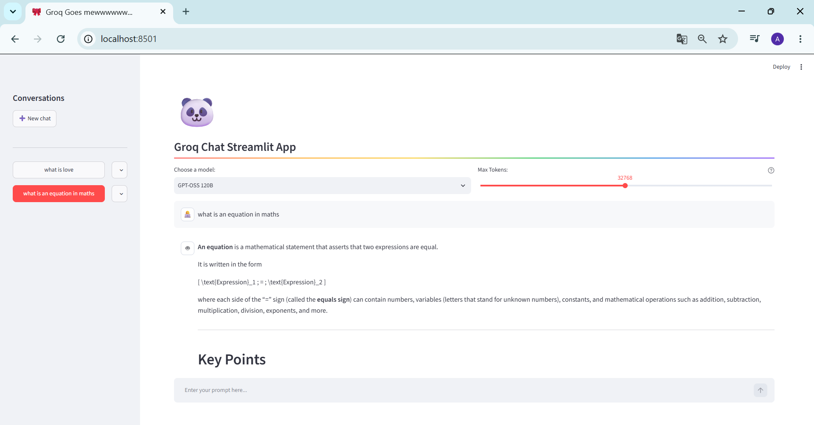

# Groq Chat Streamlit

A ChatGPT-style web app built with Streamlit and the Groq API. Answers stream in real time, you can switch between models, and every conversation is saved in a local SQLite database, so you can reopen, rename or delete it later.

**Live demo:** [link to your Streamlit app]



## Features

- Streaming responses from Groq-hosted models
- Model selector (GPT-OSS 120B, GPT-OSS 20B, Qwen 3.8 27B) and a max-tokens slider
- Persistent conversation history with SQLite
- Sidebar with all conversations, newest first, and a "New chat" button
- Rename and delete conversations (with confirmation pop-ups)
- Unit tests (pytest) for the database layer

## Tech stack

Python, Streamlit, Groq API, SQLite, pytest, uv

## Project structure

```
.
├── app.py             # Streamlit interface and chat logic
├── db.py              # SQLite helper: conversations and messages
├── test_db.py         # pytest tests for db.py
├── pyproject.toml     # dependencies (managed with uv)
└── .streamlit/
    └── secrets.toml   # your API key (not committed)
```

## Getting started

1. **Clone the repository**
   ```bash
   git clone https://github.com/[your-username]/groq-chat-streamlit.git
   cd groq-chat-streamlit
   ```

2. **Install the dependencies** (requires [uv](https://docs.astral.sh/uv/))
   ```bash
   uv sync
   ```

3. **Get a Groq API key** on [console.groq.com](https://console.groq.com) (API Keys section).

4. **Store the key** in `.streamlit/secrets.toml`:
   ```toml
   GROQ_API_KEY = "your_key_here"
   ```
   This file is listed in `.gitignore`, so your key is never pushed to GitHub.

5. **Run the app**
   ```bash
   uv run streamlit run app.py
   ```
   It opens at `http://localhost:8501`.

## Running the tests

```bash
uv run pytest -v
```

The tests use a temporary database, so your real `chat.db` is never touched.

## How it works

- `st.session_state` keeps the open conversation between Streamlit reruns.
- Each message is saved in SQLite (`conversations` and `messages` tables) as soon as it is sent or received.
- Responses are streamed with `st.write_stream`, and the full history of the open conversation is sent to the model with each prompt.

## Limitations

- The history is stored in a single SQLite file. On a deployed copy, all visitors share the same history, and the file may be reset when the server restarts. It is designed for local use or as a demo.
- Groq changes its available models regularly. If a model returns an error, check the current list at [console.groq.com/docs/models](https://console.groq.com/docs/models) and update the `models` dictionary in `app.py`.

## Credits

Based on the open-source Groq Streamlit chat demo. Extended with updated models, persistent SQLite history, conversation management and tests.